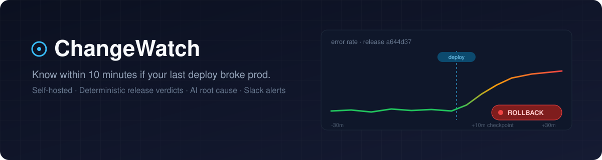
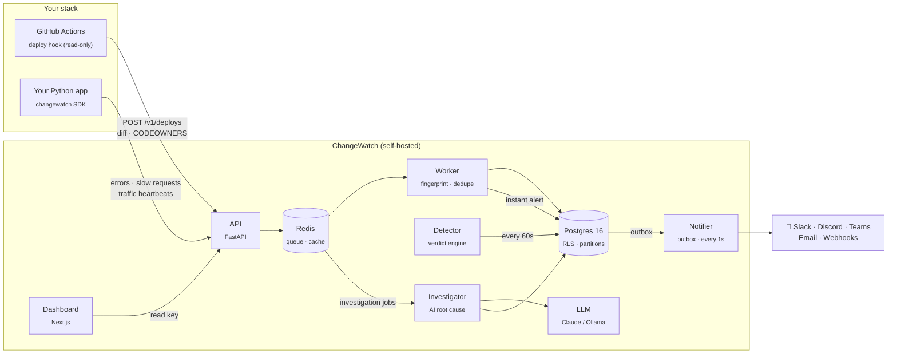
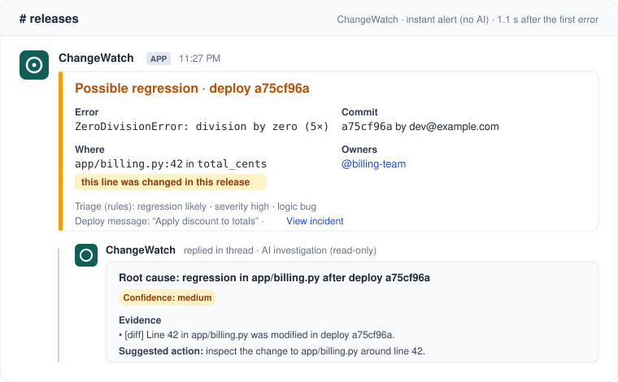
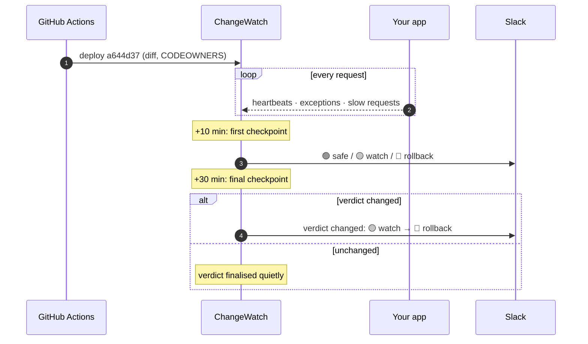
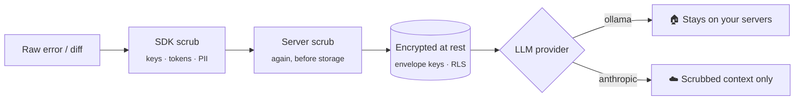

<p align="center">
  
</p>

<p align="center">
  <a href="LICENSE"></a>
  
  
  
  
  
  
  
  <br>
  
  
  
</p>

<p align="center">
  <a href="#-quick-start">Quick start</a> ·
  <a href="#-how-it-works">How it works</a> ·
  <a href="#-release-verdicts">Verdicts</a> ·
  <a href="#-instrument-your-app">SDK</a> ·
  <a href="#-performance">Performance</a> ·
  <a href="docs/SELF_HOSTING.md">Self-hosting</a> ·
  <a href="#-privacy--security">Privacy</a> ·
  <a href="docs/VERIFICATION.md">Verification guide</a> ·
  <a href="docs/ARCHITECTURE.md">How it works, end to end</a> ·
  <a href="docs/DATA_PIPELINE.md">Data pipeline</a> ·
  <a href="docs/MCP.md">MCP server</a> ·
  <a href="docs/DEMO.md">Demo</a>
</p>

---

**ChangeWatch** is an open-source, self-hosted release monitor for small Python teams. Every time you ship, it watches your errors and traffic, gives the release a **deterministic verdict** (`safe`, `watch`, `rollback` or `no_data`), explains the likely root cause with AI (Claude or a local Ollama model), and posts the result to Slack.

It answers one question, fast: **was it the deploy?**

<table>
<tr>
<td width="33%" valign="top">

### 🎯 Deterministic verdicts
Rules, not vibes. Checkpoints at **+10 min** and **+30 min** after every deploy decide `safe` / `watch` / `rollback`. Silence is never reported as safe.

</td>
<td width="33%" valign="top">

### 🧠 AI root cause
Correlates new errors with the changed lines in the diff and CODEOWNERS. Runs on **Claude** or fully local on **Ollama**, with secrets scrubbed first.

</td>
<td width="33%" valign="top">

### 🪶 Zero-dependency SDK
Pure stdlib Python. It never raises into your app, never blocks, is fork-safe, has a circuit breaker and a one-env-var kill switch.

</td>
</tr>
<tr>
<td valign="top">

### 🔔 Calm, multi-channel alerts
Slack, Discord, Teams, email or signed webhooks, with code owners tagged. Alerts are grouped and limited by hourly budgets, quiet hours and mute rules (a 10× spike still gets through). One-click action links, exactly-once outbox delivery.

</td>
<td valign="top">

### 📊 Dashboard & analytics
A Next.js dashboard with a 5-minute request/error timeline, deploy inspector, incidents with their full timeline and a one-click **postmortem draft**, analytics with CSV export, usage, and an owner fleet view.

</td>
<td valign="top">

### 🔐 Yours, end to end
Self-hosted. Envelope encryption, hashed keys, row-level security, PII scrubbing, signed webhooks, export and purge endpoints.

</td>
</tr>
</table>

---

## 🧭 How it works



1. **Deploy**: the GitHub Action posts the commit, a size-capped diff (with secret files excluded) and CODEOWNERS. It's read-only and non-blocking, so your pipeline never fails because of ChangeWatch.
2. **Observe**: the SDK streams exceptions, slow requests and minute-level traffic heartbeats from your app.
3. **Decide**: the detector compares the post-deploy window with the pre-deploy baseline and produces a verdict.
4. **Explain**: for `watch` and `rollback`, the LLM matches stack frames against the changed lines and names a likely cause and owner.
5. **Alert**: your channels receive the verdict, the reasons, the likely cause and the tagged owners.

The full walk-through of one bad deploy, process by process, with what happens when something fails: [docs/ARCHITECTURE.md](docs/ARCHITECTURE.md).

### What an alert looks like

<p align="center">
  
</p>

One message per incident: what broke, the exact file and line, whether that line changed in this release, who owns it, and a link to the incident. The AI explanation follows in the same thread. Discord, Teams, email and signed webhooks get the same content.

### The deploy lifecycle



### Under the hood

| Area | What's there |
|---|---|
| **AI SRE** | Pre-gathered deploy diffs, read-only `SELECT` tools, output verifiers that check evidence and flag dangerous fixes, and a deterministic fallback when no LLM is available (`DECISION_PROVIDER=rules`). |
| **Reliability** | Reliable Redis queue (`RPOPLPUSH`), durable outbox, `event_id` idempotency, dead-man's switch (`SILENT_AFTER_MIN`), background watchdog. |
| **Calibration** | Brier-score calibration tables track how accurate the verdicts are over time. Weekly digest. |
| **Code handling** | `CODE_MODE=stored` or `ephemeral`. An AST guard enforces that ChangeWatch never writes to your repo. |
| **Usage metering** | Integer micro-USD accounting, a configurable price book, and soft/hard budgets. Budgets can pause AI investigations only: verdicts and alerts are never metered or paused. |

---

## 🚦 Release verdicts

Verdicts come from plain, auditable rules in [`server/app/detector.py`](server/app/detector.py), evaluated in this order:

| Verdict | Fires when | What you should do |
|:---:|---|---|
| ⚪ **`no_data`** | The app sent no heartbeats or events since the deploy (dead-man's switch). | Check the SDK is running. Silence is never "safe". |
| 🔴 **`rollback`** | ≥ **20** events from brand-new issues, **or** error rate ≥ **5×** baseline with ≥ 30 errors, **or** absolute error rate ≥ **25%**. | Roll back now. The alert includes the likely cause. |
| 🟡 **`watch`** | ≥ 1 new issue with ≥ 5 events, **or** total errors ≥ **3×** baseline (min. 10). | Keep an eye on it. Something new is happening. |
| 🟢 **`safe`** | None of the above. | Ship the next one. |

Every threshold can be tuned with environment variables (see [Configuration](#%EF%B8%8F-configuration)).

---

## 🚀 Quick start

> **Requirements:** Docker + Docker Compose. That's it.

```bash
git clone https://github.com/aarizbobbydeol/changewatch.git && cd changewatch
cp .env.example .env            # add ANTHROPIC_API_KEY, or set LLM_PROVIDER=ollama
sed -i.bak "s/^MASTER_KEY=$/MASTER_KEY=$(openssl rand -hex 32)/" .env   # encryption key: back it up!
docker compose up -d            # postgres · redis · api · worker · detector · investigator · notifier · dashboard
docker compose exec api python -m app.cli create-project "my-app" \
  --slack-webhook "https://hooks.slack.com/services/..."
```

The last command prints your **ingest key** (`cw_ingest_…`) and **read key** (`cw_read_…`).

| Service | URL |
|---|---|
| API | http://localhost:8000 (`/healthz`, `/docs`) |
| Dashboard | http://localhost:3000 (enter your read key once on **Settings**; every page uses it) |

<details>
<summary><b>Want to try it without a real app?</b> Simulate deploys.</summary>

```bash
export CHANGEWATCH_API_KEY=cw_ingest_...   # the ingest key create-project printed
python scripts/simulate_deploy.py   # bad deploy → rollback, healthy → safe, silent → no_data
python scripts/demo_app.py          # FastAPI demo with /crash and /slow routes
```

</details>

<details>
<summary><b>Local development</b> (run the services on your host)</summary>

```bash
docker compose -f docker-compose.dev.yml up -d        # Postgres + Redis only
python3.12 -m venv .venv && source .venv/bin/activate
pip install -r server/requirements.txt
PYTHONPATH=server python -m app.cli create-project "my-test-app"
PYTHONPATH=server uvicorn app.main:app --reload --port 8000
```

</details>

> 🌍 **Running it 24/7 on your own domain?** See **[docs/SELF_HOSTING.md](docs/SELF_HOSTING.md)**. It covers a $5–10 VPS, automatic Let's Encrypt HTTPS through the Caddy `tls` profile, and onboarding teams as isolated projects.

---

## 🔌 Instrument your app

### 1. Add the SDK (zero dependencies)

```bash
pip install "git+https://github.com/aarizbobbydeol/changewatch.git#subdirectory=sdk"
```

```python
import os
import changewatch
from changewatch import ASGIMiddleware
from fastapi import FastAPI

cw = changewatch.init(
    api_key=os.environ["CHANGEWATCH_API_KEY"],   # cw_ingest_...
    release=os.environ.get("GIT_SHA"),           # ties events to the deploy
    endpoint="https://changewatch.example.com",
    slow_ms=1500,                                # slow-request threshold
)

app = FastAPI()
app.add_middleware(ASGIMiddleware, client=cw)   # errors, latency, heartbeats
```

Uncaught exceptions on any thread are captured automatically. You can also call `changewatch.capture_exception(exc)` manually.

| SDK guarantee | How |
|---|---|
| Never raises into your app | Every public call is wrapped and errors are counted |
| Never blocks a request | Bounded queue drained by a background daemon thread |
| Survives `fork()` | `os.register_at_fork` restarts the worker thread |
| Backs off when the server is down | Circuit breaker trips after 5 failures, exponential backoff up to 10 min |
| Can be switched off instantly | `CHANGEWATCH_DISABLED=1` turns it into a zero-overhead no-op |
| Doesn't leak secrets | Tokens, keys, emails, IPs, JWTs and card numbers are scrubbed in the SDK, and again on the server |

### 2. Add the deploy hook

```yaml
# .github/workflows/deploy.yml
permissions:
  contents: read

steps:
  - uses: actions/checkout@v4
    with: { fetch-depth: 0, persist-credentials: false }

  - uses: aarizbobbydeol/changewatch/action@main
    with:
      changewatch_url: ${{ secrets.CHANGEWATCH_URL }}
      changewatch_api_key: ${{ secrets.CHANGEWATCH_API_KEY }}
      environment: prod
```

The hook is **read-only**, **non-blocking** (`continue-on-error: true`), has a **10 s timeout**, and excludes `.env*`, `*.pem`, `*.key`, `id_rsa*`, `secrets/**` and `infra/**` from the diff. A complete example workflow is in [`action/changewatch-deploy.yml`](action/changewatch-deploy.yml).

---

## ⚡ Performance

Ingest benchmarks from [`benchmarks/optimized.json`](benchmarks/optimized.json), with **0 failed events** in every scenario:

| Scenario | Target load | Sustained | p95 | p99 |
|---|---:|---:|---:|---:|
| 🔥 Crash loop (1 fingerprint) | 5,000 ev/s | **4,999 ev/s** | 3.52 ms | 3.57 ms |
| 💥 Distinct burst (1,000 fingerprints) | 3,000 ev/s | **2,999 ev/s** | 3.54 ms | 3.66 ms |
| 🌐 Mixed realistic traffic | 1,000 ev/s | **999 ev/s** | — | 3.60 ms |
| 📈 Steady traffic | 500 ev/s | **500 ev/s** | 3.58 ms | 3.60 ms |

These results come from worker batching, a multi-process worker supervisor, storm control and backpressure shedding, sliding-window caches, a rollups table, time-partitioned events and separate connection pools.

```bash
python scripts/bench.py --compare benchmarks/baseline.json benchmarks/optimized.json
```

---

## 🔐 Privacy & security



- **Telemetry is off by default** (`TELEMETRY_ENABLED=0`). If you enable it, only coarse, bucketed fleet metadata is sent, and you can preview the exact payload at `GET /v1/telemetry/preview`. Source code, repository names, file paths, stack traces, emails, IPs and credentials are **never** collected, and the schema rejects them (`extra="forbid"`).
- **Fully local mode:** `LLM_PROVIDER=ollama` + `DECISION_PROVIDER=rules` means no customer data leaves your infrastructure.
- **Key hygiene:** ingest and read keys have separate roles and are stored hashed. Logs are redacted. Master keys can be rotated with the CLI.
- **Transport:** an optional Caddy profile provides automatic TLS. Internal services sit on a private network, and outbound webhooks are signed.
- **Your data:** configurable retention (`RETENTION_DAYS`), partition drops in O(1), and export and purge endpoints.

See [`docs/SECURITY_MODEL.md`](docs/SECURITY_MODEL.md) and run the audit script yourself with `python scripts/security_check.py`.

---

## ⚙️ Configuration

<details>
<summary><b>Core environment variables</b></summary>

| Variable | Default | Description |
|---|---|---|
| `MASTER_KEY` | **required** | 256-bit encryption key (`openssl rand -hex 32`). Compose refuses to start without it. Back it up. |
| `POSTGRES_USER` / `POSTGRES_PASSWORD` / `POSTGRES_DB` | `changewatch` | Postgres credentials. Compose builds every service's `DATABASE_URL` from them. |
| `REDIS_PASSWORD` | `changewatch_secret_password` | Redis password |
| `DATABASE_URL` | `postgresql://...` | PostgreSQL 16 connection URL (local development without Docker) |
| `REDIS_URL` | `redis://...` | Redis 7 connection URL |
| `LLM_PROVIDER` | `anthropic` | `anthropic`, `ollama`, or `fake` |
| `ANTHROPIC_API_KEY` | `""` | API key for Anthropic Claude |
| `LLM_MODEL_FAST` / `LLM_MODEL_DEEP` | `claude-sonnet-5-5` / `claude-opus-5-5` | Anthropic models for automatic investigations and for "Dig deeper" (`LLM_MODEL` is still read as the fast model) |
| `OLLAMA_BASE_URL` | `http://host.docker.internal:11434` | Ollama HTTP endpoint |
| `OLLAMA_MODEL` | `llama3` | Ollama model tag |
| `RATE_LIMIT_PER_MIN` | `600` | Max ingest events per minute per API key |
| `HEARTBEAT_LIMIT_PER_MIN` | `1200` | Max traffic heartbeats per minute per key (one per app process); extra ones are dropped, never the errors |
| `VERDICT_FIRST_MIN` | `10` | Minutes after deploy for the first checkpoint |
| `VERDICT_FINAL_MIN` | `30` | Minutes after deploy for the final checkpoint |
| `VERDICT_ROLLBACK_NEW_ISSUE_EVENTS` | `20` | New-issue events that trigger `rollback` |
| `VERDICT_ROLLBACK_ABS_RATE` | `0.25` | Absolute error rate that triggers `rollback` |
| `NOTIFY_ON_SAFE` | `1` | Also send alerts for `safe` verdicts |
| `SILENT_AFTER_MIN` | `10` | Minutes of silence before the dead-man's switch fires |
| `SYSTEM_ALERT_WEBHOOK_URL` | `""` | Operator fallback channel: tells you when ChangeWatch itself is unwell (a service down, alerts undeliverable) |
| `DECISION_PROVIDER` | `rules` | `rules` (deterministic, on-prem), `jev` (TypeSafe Jev), or `fake` |
| `CODE_MODE` | `stored` | `stored` or `ephemeral` handling of deploy code |
| `PUBLIC_HOSTNAME` | `localhost` | Domain Caddy provisions HTTPS for (`--profile tls`) |
| `RETENTION_DAYS` | `30` | Days to keep events before cleanup |
| `SCRUB_PII` | `1` | Scrub emails, IPs, JWTs and card numbers |
| `TELEMETRY_ENABLED` | `0` | Opt-in anonymous fleet telemetry |
| `SEED_DEV_PROJECT` | `0` | If `1`, seeds `cw_test_key_123` on startup |

See [`.env.example`](.env.example) for the full list.

</details>

---

## 🗂️ Project layout

```text
changewatch/
├── server/        FastAPI API, worker, detector, notifiers, analytics, CLI, migrations
├── sdk/           Zero-dependency Python SDK + ASGI middleware (+ tests)
├── dashboard/     Next.js dashboard: timeline, incidents, analytics, usage
├── action/        GitHub Action + standalone deploy-hook workflow
├── evals/         12 root-cause scenarios (rename, typo, none-return, false alarm, …)
├── benchmarks/    Baseline vs. optimized ingest benchmarks
├── scripts/       Demo app, deploy simulator, load test, chaos, security audit
├── caddy/         Optional automatic-TLS reverse proxy
├── collector/     Opt-in telemetry collector service
└── docs/          Self-hosting, security model, data pipeline, metrics, pricing, verification guide
```

## 🧪 Testing

| Suite | Command | Result |
|---|---|:---:|
| Unit + integration | `.venv/bin/pytest server/tests sdk/tests` | ✅ 288 passed · 2 skipped |
| AI SRE evals (12 scenarios, 5× determinism check) | `.venv/bin/python -m evals.run --provider fake` | ✅ 12 / 12 |
| Security & read-only compliance audit | `.venv/bin/python scripts/security_check.py` | ✅ 12 / 12 |
| Chaos (network blips, stuck workers, outbox retries, detector lag) | `.venv/bin/python scripts/chaos.py` | zero lost events, zero duplicate alerts |

The 2 skipped tests need live Postgres and Redis. Start them with `docker compose -f docker-compose.dev.yml up -d`.

Every milestone has a step-by-step manual check with expected output in **[docs/VERIFICATION.md](docs/VERIFICATION.md)**.

---

## 🤝 Contributing

Issues and PRs are welcome. Read [CONTRIBUTING.md](CONTRIBUTING.md) and the [Code of Conduct](CODE_OF_CONDUCT.md) first. Report security issues privately as described in [SECURITY.md](SECURITY.md). Design decisions are logged in [DECISIONS.md](DECISIONS.md).

## 📄 License

[Apache 2.0](LICENSE)
