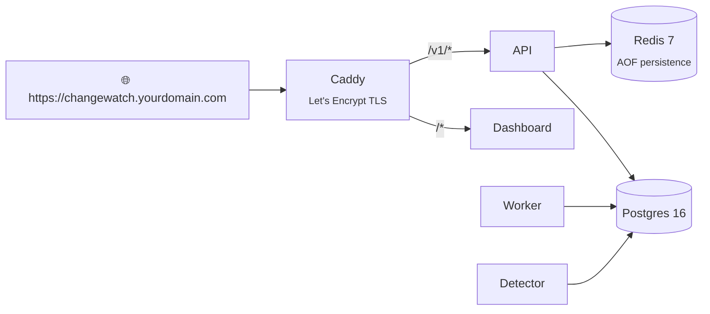

# Self-hosting ChangeWatch 24/7

Run ChangeWatch on your own domain with automatic HTTPS, then onboard teams as isolated projects.



## 1. Server requirements

| | Minimum |
|---|---|
| OS | Ubuntu 22.04 / 24.04 LTS |
| Size | 2 vCPU · 4 GB RAM · 40 GB SSD (about $5–10/month on Hetzner, DigitalOcean, Linode, EC2 or GCP) |
| Software | Docker + Compose v2: `sudo apt install docker.io docker-compose-v2` |

## 2. Point your domain at the server

At your DNS provider, add an **A record**:

| Type | Name | Value |
|---|---|---|
| `A` | `changewatch` (or `@`) | `<YOUR_VPS_PUBLIC_IP>` |

## 3. Clone and configure

```bash
git clone https://github.com/aarizbobbydeol/changewatch.git /opt/changewatch
cd /opt/changewatch
cp .env.example .env
```

Edit `/opt/changewatch/.env`:

```env
# Caddy provisions a Let's Encrypt certificate for this host
PUBLIC_HOSTNAME=changewatch.yourdomain.com

# Encryption master key (required). Generate once and BACK IT UP:
# losing it makes stored stack traces and diffs unreadable.
MASTER_KEY=<openssl rand -hex 32>

# Strong random secrets (openssl rand -hex 32: hex is safe inside URLs)
POSTGRES_PASSWORD=<openssl rand -hex 32>
REDIS_PASSWORD=<openssl rand -hex 32>

# AI root cause: anthropic, ollama, or fake
LLM_PROVIDER=anthropic
ANTHROPIC_API_KEY=sk-ant-...

# Typed decisions: rules (deterministic, on-prem) or jev (TypeSafe Jev)
DECISION_PROVIDER=rules
# JEV_API_KEY=...

# Opt-in telemetry stays off
TELEMETRY_ENABLED=0
```

Quick way to fill in all three secrets:

```bash
for v in MASTER_KEY POSTGRES_PASSWORD REDIS_PASSWORD; do
  sed -i "/^$v=/d" .env && echo "$v=$(openssl rand -hex 32)" >> .env
done
```

> [!IMPORTANT]
> - `docker compose` refuses to start until `MASTER_KEY` is set.
> - Set `POSTGRES_PASSWORD` **before the first** `docker compose up`. Postgres only reads it when it creates its data volume. To change it later, run `ALTER USER` inside Postgres, then update `.env`.
> - Keep Postgres off the public internet: open only ports 80 and 443 in your firewall.

## 4. Start the stack with HTTPS

```bash
docker compose --profile tls up -d
```

| Service | Role |
|---|---|
| **postgres** | Postgres 16. Migrations apply automatically on API startup |
| **redis** | Redis 7 with AOF persistence for the reliable ingest queue |
| **api** | FastAPI: ingest, read APIs, action-link receivers |
| **worker** | Multi-process fingerprinting and event processing |
| **detector** | 10 / 30 min release verdicts, spike detection, watchdog |
| **dashboard** | Next.js web UI |
| **caddy** | Reverse proxy that requests and renews the TLS certificate |

Every service uses `restart: unless-stopped`. Make sure Docker itself starts on boot:

```bash
sudo systemctl enable docker
```

Check it's live:

```bash
curl -s https://changewatch.yourdomain.com/healthz
```

## 5. Onboard a team

Each team gets its own project, isolated with Postgres row-level security and its own encrypted data key.

```bash
docker compose exec api python -m app.cli create-project "friend-app" \
  --slack-webhook "https://hooks.slack.com/services/T000/B000/XXXX"
```

The CLI prints two keys **once**. Only their SHA-256 hashes are stored.

| Key | Prefix | Used by |
|---|---|---|
| Ingest key | `cw_ingest_…` | The app's SDK and the GitHub Action |
| Read key | `cw_read_…` | The dashboard and read APIs |

Add more alert channels (Discord, Teams, email, generic webhook) with `add-channel`:

```bash
docker compose exec api python -m app.cli list-projects
docker compose exec api python -m app.cli add-channel <PROJECT_ID> discord \
  --config '{"webhook_url": "https://discord.com/api/webhooks/..."}'
docker compose exec api python -m app.cli add-channel <PROJECT_ID> teams \
  --config '{"webhook_url": "https://outlook.office.com/webhook/..."}'
```

Map git authors to chat handles so alerts tag the right owner with `add-member` (`--git-emails`, `--slack-user-id`, `--discord-user-id`, `--email`).

## 6. What the team does (about 5 minutes)

**a. Track deploys.** In `.github/workflows/deploy.yml`:

```yaml
- uses: aarizbobbydeol/changewatch/action@main
  with:
    changewatch_url: https://changewatch.yourdomain.com
    changewatch_api_key: ${{ secrets.CHANGEWATCH_API_KEY }}
    environment: prod
```

**b. Install the SDK** (pure standard library):

```bash
pip install "git+https://github.com/aarizbobbydeol/changewatch.git#subdirectory=sdk"
```

```python
import os
import changewatch
from changewatch import ASGIMiddleware

cw = changewatch.init(
    api_key=os.environ["CHANGEWATCH_API_KEY"],      # cw_ingest_...
    endpoint="https://changewatch.yourdomain.com",
    release=os.environ.get("GIT_SHA"),
    environment="prod",
)
app.add_middleware(ASGIMiddleware, client=cw)
```

**c. Open the dashboard** at `https://changewatch.yourdomain.com` and paste the read key (`cw_read_…`) into the top bar. The dashboard shows deploy markers on the error timeline, incidents tagged with file, line and author, AI root-cause investigations, and one-click actions (*I'm on it*, *Mute*, *False alarm*).

**d. Smoke test.** Raise an exception from any endpoint. An incident alert arrives in the team's channel, and the first release verdict follows at the +10 minute checkpoint.
