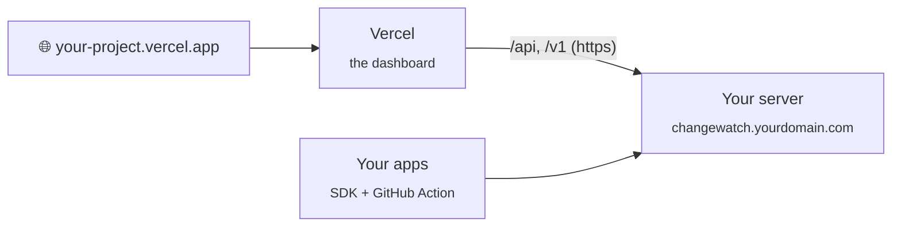

# The dashboard on Vercel (optional)

ChangeWatch itself runs on your server: its API, workers, Postgres and Redis have to run all the time, and Vercel only runs websites on demand. The dashboard is a Next.js app, so it can also live on Vercel. People open `https://your-project.vercel.app`, and Vercel passes the dashboard's requests on to your server.

Your server's own dashboard keeps working. Vercel is just a second address for it.



## Before you start

- ChangeWatch running on a server with a domain and HTTPS: the one command with `--domain` ([SELF_HOSTING.md](SELF_HOSTING.md)). Check that `https://changewatch.yourdomain.com/healthz` answers in your browser.
- A Vercel account. The free Hobby plan is for personal, non-commercial use; Vercel asks for the Pro plan for anything commercial.

## Steps

1. On [vercel.com/new](https://vercel.com/new), import your copy of this repository (fork it first if it isn't yours).
2. **Root Directory:** `dashboard`. Vercel detects Next.js by itself.
3. **Environment Variables:** add `API_URL` with your server's address, for example `https://changewatch.yourdomain.com`. It must start with `https://`, or the build stops and says so: every request carries a project key.
4. **Deploy.** Vercel shows your address, for example `https://your-project.vercel.app`.
5. On your server, make alert links open that address. Running the installer again keeps everything else:

   ```bash
   curl -fsSL https://raw.githubusercontent.com/aarizbobbydeol/changewatch/main/scripts/install.sh | sudo bash -s -- --dashboard-url https://your-project.vercel.app
   ```

6. Open your Vercel address, go to **Settings** and paste your project's read key.

## Good to know

- **Changing `API_URL`:** redeploy afterwards (Deployments → Redeploy). Next.js fixes the address when it builds.
- **Updates:** every push to your repository redeploys the dashboard. Keep it on the same version as your server.
- **Privacy:** requests, including the project key, pass through Vercel on their way to your server, over HTTPS. If that matters to you, use your server's own dashboard instead.
- **Slow answers:** Vercel waits up to 120 seconds for your server, far more than any dashboard request needs.
- **"Could not reach the API" on every page:** open `https://changewatch.yourdomain.com/healthz` yourself. If that fails, the server is the problem (see `docker compose logs api` on it). If it works, check `API_URL` for a typo and redeploy.
